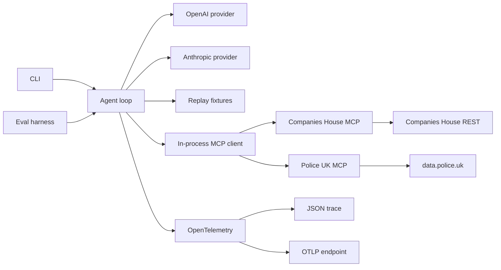

# UK Public Research Agent

A small tool-calling research agent over two public UK datasets. It is built to show the pieces a senior reviewer looks for in applied-AI work: typed tool contracts, a bounded agent loop, traces with cost, and an eval suite that CI can run with no network and no API keys.

The agent answers questions such as "Summarise this company's officers and recent filings" or "Compare street-level crime at two points". Every factual claim in a scored answer has to be present in a tool result.

## Why these two sources

Companies House is the public register of UK companies. Its REST API needs a free API key (`COMPANIES_HOUSE_API_KEY`) and exposes search, company profile, officers, and filing history. The tools drop officer home addresses and dates of birth before anything reaches the model or a trace.

Police UK (`data.police.uk`) is the second source because it needs no key, has a stable street-level crime API, and is the dataset that can answer "compare crime in two areas". Nomis and the ONS beta API are public too, but they either expect a key or return large statistical cubes that are a poor fit for a short tool contract. Street-level counts are small after aggregation, and the coverage limit is explicit: Scotland in this API is British Transport Police only, so those figures are not comparable with England and Wales. The tool says so on every response.

The Police UK numbers in `evals/fixtures/police-recorded.json` were read from that API on 2026-11-20 (`crime-last-updated` was 2026-09-01). Companies House examples in the eval suite are synthetic. Names such as NORTHSTAR ANALYTICS LTD are not live register extracts.

## Architecture



Each MCP server is its own package and a stdio binary (`companies-house-mcp`, `police-uk-mcp`). The CLI talks to them in-process through the official SDK's in-memory transport, which is the same protocol a stdio host would use. Replay mode never starts a server: it serves the recorded tool results.

## Design trade-offs

- **Fetch adapters, not vendor SDKs.** OpenAI and Anthropic sit behind one `ModelProvider`. A few dozen lines of request mapping are easier to test than two large SDKs, and both still speak their real HTTP APIs.
- **Deterministic checks decide pass or fail.** The harness checks tool name and arguments, that required facts appear in the answer and in the tool output, that forbidden claims are absent, and that numbers in the answer occur in the question or the tool output. The LLM-as-judge rubric is in `packages/eval/src/rubric.ts`. In replay, the judge score is the recorded JSON for that rubric, parsed by the same schema a live judge must satisfy. Replay therefore does not measure a live model. It fails if the loop drops a call, reorders a strict sequence, ignores a step or budget limit, or lets an ungrounded fact through.
- **Crime is aggregated.** The street-level API returns one object per crime, including identifiers. The tool returns counts by category and a coverage note. Individual identifiers are not stored in the fixture or sent to the model.
- **Filing descriptions stay as API enumeration keys** (`accounts-with-accounts-type-full`) plus `description_values`. Turning those keys into the prose on the Companies House website needs a second dataset this repo does not ship.
- **Cost is an estimate, not an invoice.** `packages/agent/src/prices.ts` uses uncached public list prices checked on 2026-11-20 against the OpenAI and Anthropic pricing pages. Cached input is billed as full input, so the estimate is at or above the invoice. Unknown model ids use the highest rate in the table.
- **Traces default to JSON.** Spans for the run, each step, each model call, and each tool call carry tokens, latency, and the cost estimate. Secrets are scrubbed from attributes. Set `OTEL_EXPORTER_OTLP_ENDPOINT` to also export OTLP/HTTP. `TRACE_EXPORTER=console` adds the SDK console exporter.

## Layout

| Path                                  | What it is                                                  |
| ------------------------------------- | ----------------------------------------------------------- |
| `packages/http`                       | Retries, `Retry-After`, backoff, request spacing, redaction |
| `packages/companies-house-mcp`        | Companies House tools and stdio server                      |
| `packages/police-uk-mcp`              | Police UK tools, aggregation, stdio server, `record` script |
| `packages/agent`                      | Provider interface, agent loop, limits                      |
| `packages/tracing`                    | OpenTelemetry setup, JSON spans, text trace                 |
| `packages/eval`                       | Rubric, scoring, 28 golden tasks, replay runner             |
| `packages/cli`                        | `demo`, `eval`, `trace`                                     |
| `evals/fixtures/police-recorded.json` | Recorded Police UK snapshot                                 |
| `evals/results/`                      | Committed replay summary. Latency is not stored             |

## Run it

Node 22 or newer.

```bash
npm install
npm run demo
npm test
npm run eval:replay
```

`npm run demo` is offline. It replays "Summarise NORTHSTAR ANALYTICS LTD's officers and recent filings", prints the answer and a trace, and writes `runs/demo-trace.json`.

```text
Status: completed
Tokens: 1200 in / 240 out
Estimated cost: $0.00078
```

Other commands:

```bash
npm run eval:replay          # writes evals/results and exits non-zero if a task fails
npm run eval:live            # real model and real APIs; needs a provider key
npm run trace -- runs/demo-trace.json
npm run record:police        # refresh the Police UK snapshot from the public API
```

Live mode uses `RESEARCH_PROVIDER=openai|anthropic` and `OPENAI_API_KEY` or `ANTHROPIC_API_KEY`. Optional `RESEARCH_MODEL` overrides the default (`gpt-5-mini` or `claude-sonnet-4-5`). Companies House live tasks are skipped, with a message, when `COMPANIES_HOUSE_API_KEY` is unset. Police UK live tasks do not need a key. Copy `.env.example` and export the variables yourself. The process does not read a dotenv file.

Stdio servers, for an MCP host:

```bash
npm run build
COMPANIES_HOUSE_API_KEY=... node packages/companies-house-mcp/dist/main.js
node packages/police-uk-mcp/dist/main.js
```

Logs go to stderr. Stdout is the MCP protocol. API keys are not written to logs.

## Eval results

Replay mode, from `npm run eval:replay` in this workspace. These numbers are computed from the recorded fixtures and the price table. They are not a live model run.

| Measure                 | Result   |
| ----------------------- | -------- |
| Tasks                   | 28       |
| Passed                  | 28       |
| Pass rate               | 1        |
| Mean tool-call accuracy | 1        |
| Mean groundedness       | 1        |
| Mean judge score        | 5        |
| Input tokens            | 26200    |
| Output tokens           | 5240     |
| Estimated cost          | $0.01703 |

The same command printed `Mean latency: 0.357 ms on this machine.` That latency is not in `evals/results/replay.summary.json` or `replay.md`, and CI does not compare it. The mean judge score is 5 because every recorded judge output scores the scripted answer as fully supported. That is the replay contract, not an estimate of a live model's quality.

CI (`.github/workflows/ci.yml`) runs lint, typecheck, test, build, and `npm run eval:replay`, then `git diff --exit-code` on the two committed result files. Tests replace `fetch` and throw if a case reaches the network.

## Limits and next steps

- Replay does not call OpenAI, Anthropic, Companies House, or Police UK. Live mode does, and its smoke questions are scored on tool arguments, numeric groundedness, and a real judge call. It is not part of CI.
- The Companies House golden data is synthetic. A live search for NORTHSTAR ANALYTICS LTD will not return company `12345678`.
- Police UK figures are a snapshot. A later month, or a revision of 2026-08, will not match the fixture until `npm run record:police` is run again.
- The agent stops at a step limit, a token budget, or a cost budget and returns the tool results it already has. It does not plan a multi-session investigation or keep memory.
- Officer pages and filing history are capped at 10 items and report `truncated` when the register has more.
- The UK bounding box used by the crime tool is latitude 49 to 61 and longitude -8.7 to 1.9. Points outside that box are rejected before the HTTP call.
- Price rows will go stale when vendors change list prices. Update `packages/agent/src/prices.ts`; the budget uses that table only.
