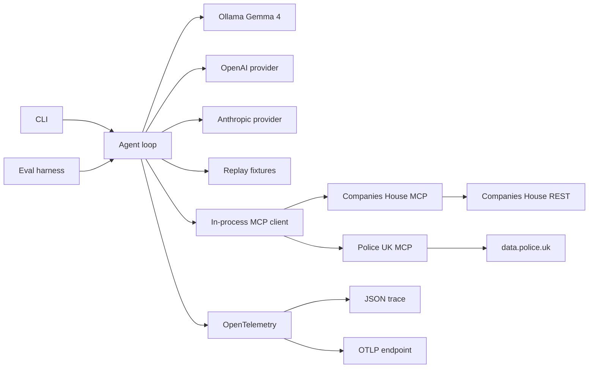

# uk-research-agent

A tool-calling research agent over public UK data. It is a portfolio project: two MCP servers, one agent loop, OpenTelemetry tracing, and a record/replay eval harness. The default model path is local and costs $0: Gemma 4 through Ollama, tag `gemma4:31b`. OpenAI and Anthropic providers exist, and CI never calls them.

The agent answers questions such as "Summarise this company's officers and recent filings" or "Compare street-level crime at two points". A scored answer has to take its facts from tool results.

## What is in the box

- **Companies House MCP server** (`packages/companies-house-mcp`). Search, profile, officers, and filing history against the public REST API. The API key comes from `COMPANIES_HOUSE_API_KEY`. Officer home addresses and dates of birth are dropped before the model or a trace sees them.
- **Police.uk MCP server** (`packages/police-uk-mcp`). Forces, crime categories, and street-level counts from `data.police.uk`. No API key. Counts are aggregated; individual crime identifiers are not stored.
- **Agent** (`packages/agent`). A tool-calling loop with a step limit, a token budget, and a cost budget. Ollama, OpenAI, and Anthropic sit behind one provider interface.
- **OpenTelemetry tracing** (`packages/tracing`). One span per run, step, model call, and tool call, with tokens, latency, and a cost estimate. The default export is JSON. An OTLP endpoint is optional.
- **Record/replay eval harness** (`packages/eval`). Twenty-eight golden tasks. Replay uses recorded tool responses and recorded model responses, so CI does not use the network. `npm run eval:local` is the live-model path: a real local model, with those same tool fixtures.

## Status

Checked in this repository on 2026-11-20:

- `npm test`: 59 tests passed.
- `npm run eval:replay`: 28 of 28 offline tasks passed. Those figures are in the table below. They are not a live model run.
- Live Gemma 4 (`npm run eval:local` with `gemma4:31b`): not run yet. There is no live score in this repo.

## Why these two sources

Companies House is the public register of UK companies. Its REST API needs a free API key (`COMPANIES_HOUSE_API_KEY`) and exposes search, company profile, officers, and filing history. The tools drop officer home addresses and dates of birth before anything reaches the model or a trace.

Police UK (`data.police.uk`) is the second source because it needs no key, has a stable street-level crime API, and is the dataset that can answer "compare crime in two areas". Nomis and the ONS beta API are public too, but they either expect a key or return large statistical cubes that are a poor fit for a short tool contract. Street-level counts are small after aggregation, and the coverage limit is explicit: Scotland in this API is British Transport Police only, so those figures are not comparable with England and Wales. The tool says so on every response.

The Police UK numbers in `evals/fixtures/police-recorded.json` were read from that API on 2026-11-20 (`crime-last-updated` was 2026-09-01). Companies House examples in the eval suite are synthetic. Names such as NORTHSTAR ANALYTICS LTD are not live register extracts.

## Architecture



Each MCP server is its own package and a stdio binary (`companies-house-mcp`, `police-uk-mcp`). The CLI talks to them in-process through the official SDK's in-memory transport, which is the same protocol a stdio host would use. Replay mode never starts a server: it serves the recorded tool results.

## Design trade-offs

- **Fetch adapters, not vendor SDKs.** Ollama, OpenAI, and Anthropic sit behind one `ModelProvider`. Ollama uses its native `/api/chat` tool-calling API. `OLLAMA_BASE_URL` defaults to `http://127.0.0.1:11434` and `OLLAMA_MODEL` defaults to `gemma4:31b`. Gemma 4 is on the Ollama library (`gemma4:e2b`, `e4b`, `12b`, `26b`, `31b`). A malformed tool call is sent back once; a second malformed call fails the request. Arguments that fail the tool's zod schema are returned to the model once, and a second invalid call stops the run. Local token cost is $0. Tokens and latency are still recorded.
- **The local judge is the same model.** It grades its own answer. That is weaker than a separate frontier judge, and a smaller Gemma tag is weaker still. Pass/fail still requires the judge score to be at least 4, so a weak judge can move the pass rate. The tool, fact, and number checks are the reliable signal.
- **Deterministic checks decide pass or fail.** The harness checks tool name and arguments, that required facts appear in the answer and in the tool output, that forbidden claims are absent, and that numbers in the answer occur in the question or the tool output. The LLM-as-judge rubric is in `packages/eval/src/rubric.ts`. In replay, the judge score is the recorded JSON for that rubric, parsed by the same schema a live judge must satisfy. Replay therefore does not measure a live model. It fails if the loop drops a call, reorders a strict sequence, ignores a step or budget limit, or lets an ungrounded fact through.
- **Crime is aggregated.** The street-level API returns one object per crime, including identifiers. The tool returns counts by category and a coverage note. Individual identifiers are not stored in the fixture or sent to the model.
- **Filing descriptions stay as API enumeration keys** (`accounts-with-accounts-type-full`) plus `description_values`. Turning those keys into the prose on the Companies House website needs a second dataset this repo does not ship.
- **Cost is an estimate, not an invoice.** `packages/agent/src/prices.ts` uses uncached public list prices checked on 2026-11-20 against the OpenAI and Anthropic pricing pages. Cached input is billed as full input, so the estimate is at or above the invoice. Unknown model ids use the highest rate in the table.
- **Traces default to JSON.** Spans for the run, each step, each model call, and each tool call carry tokens, latency, and the cost estimate. Secrets are scrubbed from attributes. Set `OTEL_EXPORTER_OTLP_ENDPOINT` to also export OTLP/HTTP. `TRACE_EXPORTER=console` adds the SDK console exporter.

## Layout

| Path                                  | What it is                                                  |
| ------------------------------------- | ----------------------------------------------------------- |
| `packages/http`                       | Retries, `Retry-After`, backoff, request spacing, redaction |
| `packages/companies-house-mcp`        | Companies House tools and stdio server                      |
| `packages/police-uk-mcp`              | Police UK tools, aggregation, stdio server, `record` script |
| `packages/agent`                      | Provider interface, including Ollama, and the agent loop    |
| `packages/tracing`                    | OpenTelemetry setup, JSON spans, text trace                 |
| `packages/eval`                       | Rubric, scoring, 28 golden tasks, replay runner             |
| `packages/cli`                        | `demo`, `eval`, `trace`                                     |
| `evals/fixtures/police-recorded.json` | Recorded Police UK snapshot                                 |
| `evals/results/`                      | Committed replay summary. Latency is not stored             |

## Install and run

Node 22 or newer.

```bash
npm install
npm test
npm run eval:replay
```

`npm test` and `npm run eval:replay` stay offline. `npm run demo` replays one scripted question and writes `runs/demo-trace.json`.

To run the 28-task eval against a local Ollama server and `gemma4:31b`:

```bash
ollama pull gemma4:31b
export OLLAMA_BASE_URL=http://127.0.0.1:11434
export OLLAMA_MODEL=gemma4:31b
npm run eval:local
```

Ollama has to be running before that command. This repo does not install Ollama or download the model. The command writes `evals/results/live-gemma4-31b.summary.json` and, after each task, `evals/results/live-gemma4-31b.partial.json`. Run the same command again to continue a stopped run. `npm run eval:local -- --fresh` starts over.

`npm run demo` is offline. It replays "Summarise NORTHSTAR ANALYTICS LTD's officers and recent filings", prints the answer and a trace, and writes `runs/demo-trace.json`.

```text
Status: completed
Tokens: 1200 in / 240 out
Estimated cost: $0.00078
```

Other commands:

```bash
npm run eval:replay          # offline fixtures; CI runs this
npm run eval:local           # real local Ollama, recorded tool responses
npm run eval:live            # paid OpenAI or Anthropic, plus live APIs
npm run trace -- runs/demo-trace.json
npm run record:police        # refresh the Police UK snapshot from the public API
```

`npm run eval:local` uses recorded tool responses, so Companies House does not need a key. `npm run eval:local -- --tools live` calls the live Police.uk API for police tools. Companies House stays on fixtures unless `COMPANIES_HOUSE_API_KEY` is set.

The summary file records the model tag, a hardware description from `os` and `process` (CPU model, architecture, memory, Node version), the date, pass rate, tool-call accuracy, groundedness, judge score, tokens, latency, and cost. Local cost is $0. The pass rule matches replay: exact tool arguments, grounded facts, and a judge score of at least 4. The judge is the same local model, so that score is weaker than a separate frontier judge. No live result is included here, because that command has not been run in this repository.

`npm run eval:live` uses `RESEARCH_PROVIDER=openai|anthropic` and `OPENAI_API_KEY` or `ANTHROPIC_API_KEY`. Optional `RESEARCH_MODEL` overrides the default (`gpt-5-mini` or `claude-sonnet-4-5`). Companies House live tasks are skipped, with a message, when `COMPANIES_HOUSE_API_KEY` is unset. Police UK live tasks do not need a key. Copy `.env.example` and export the variables yourself. The process does not read a dotenv file. CI does not run `eval:local` or `eval:live`.

Stdio servers, for an MCP host:

```bash
npm run build
COMPANIES_HOUSE_API_KEY=... node packages/companies-house-mcp/dist/main.js
node packages/police-uk-mcp/dist/main.js
```

Logs go to stderr. Stdout is the MCP protocol. API keys are not written to logs.

## Eval results

Replay mode, from `npm run eval:replay` in this workspace. These numbers are computed from the recorded fixtures and the price table. They are not a live model run.

| Measure                 | Result   |
| ----------------------- | -------- |
| Tasks                   | 28       |
| Passed                  | 28       |
| Pass rate               | 1        |
| Mean tool-call accuracy | 1        |
| Mean groundedness       | 1        |
| Mean judge score        | 5        |
| Input tokens            | 26200    |
| Output tokens           | 5240     |
| Estimated cost          | $0.01703 |

The same command printed `Mean latency: 0.357 ms on this machine.` That latency is not in `evals/results/replay.summary.json` or `replay.md`, and CI does not compare it. The mean judge score is 5 because every recorded judge output scores the scripted answer as fully supported. That is the replay contract, not an estimate of a live model's quality.

| Run                                | Result            |
| ---------------------------------- | ----------------- |
| Replay, fake model, recorded tools | The table above   |
| Live local, `gemma4:31b` on Ollama | Pending local run |

No live-local numbers are checked in. Run `npm run eval:local` on the machine that has the model, then read `evals/results/live-gemma4-31b.summary.json`. Per-task `failures` are the failure-mode list: missed or mistyped tool arguments, facts that were not copied from the fixture, a judge score under 4, and the three limit tasks described above.

CI (`.github/workflows/ci.yml`) runs lint, typecheck, test, build, and `npm run eval:replay`, then `git diff --exit-code` on the two committed result files. Tests replace `fetch` and throw if a case reaches the network.

## Limits and next steps

- Replay does not call OpenAI, Anthropic, Companies House, or Police UK. Live mode does, and its smoke questions are scored on tool arguments, numeric groundedness, and a real judge call. It is not part of CI.
- The Companies House golden data is synthetic. A live search for NORTHSTAR ANALYTICS LTD will not return company `12345678`.
- Police UK figures are a snapshot. A later month, or a revision of 2026-08, will not match the fixture until `npm run record:police` is run again.
- The agent stops at a step limit, a token budget, or a cost budget and returns the tool results it already has. It does not plan a multi-session investigation or keep memory.
- Officer pages and filing history are capped at 10 items and report `truncated` when the register has more.
- The UK bounding box used by the crime tool is latitude 49 to 61 and longitude -8.7 to 1.9. Points outside that box are rejected before the HTTP call.
- Price rows for the paid models will go stale when vendors change list prices. Update `packages/agent/src/prices.ts`. Gemma 4 tags and any provider marked local are priced at $0; a positive cost budget therefore does not stop a local run.
- Ollama is not installed or pulled by this repo. `npm run eval:local` fails fast, and keeps finished tasks, if nothing is listening at `OLLAMA_BASE_URL`. One request is not retried; the default timeout is 300 seconds (`OLLAMA_TIMEOUT_MS`).
